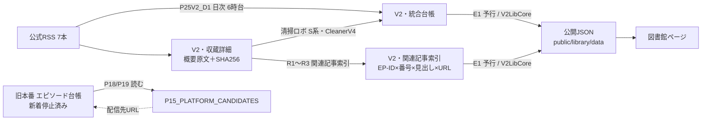

# V2データ品質・統合監査（2026-11-14）

本番データへの書き込みなし。実測と未実行を分けて書く。

## 1. データの流れ（現行）

- 公開JSON（現行の公開版は 2026-10-22 生成）の関連記事は **URLのみの配列**（見出しなし）。610話・1,750件。
- 新しい公開データ生成（`V2LibCore.buildV2Library`）は `relatedArticles: [{title,url}]` を1話に複数持てる。互換のため `related`（URL配列）も残している。
- 配信先リンクは公開JSONで `links`（URLの配列・サービス名なし）。個別サービス表示には `{サービス: URL}` 形式の追加が必要。

## 2. URL（実測：V2・統合台帳 6,591行、2026-11-14 15時台に読み取り）

| サービス | 入っている | 空 | 個別EPの形 | 番組トップ | 形が不明 | 同じURLを共有 |
|---|---|---|---|---|---|---|
| Spotify | 6,544 | 47 | 6,544 | 0 | 0 | 265組（264組は代表EP-IDで束ねた同一内容、1組は片方が対象外） |
| Apple Podcasts | 752 | 5,839 | 751 | 1（EP-06632） | 0 | 0 |
| Amazon Music | 0 | 6,591 | − | − | − | − |
| Pocket Casts | 6,531 | 60 | 6,531 | 0 | 0 | 272組（271組は束ね済み、1組は片方が対象外） |
| LISTEN | 3,918 | 2,673 | 3,918 | 0 | 0 | 0 |
| Pody | 0 | 6,591 | − | − | − | − |
| YouTube | 0 | 6,591 | − | − | − | − |

- 判定は「URLの形」だけ。リンク先が同じ回かどうかは **未照合**（別判定。推測URLは作らない）。
- Spotify が空の47行のうち46行は 2026年10月中旬以降の回（V2収蔵ロボが入れた回）。旧本番側の P18/P19 は旧本番の台帳だけを見ているため、**V2で収蔵した回には配信先URLが入らない**。これが移行の影響範囲。
- Apple は番組ごとの偏りが大きい（SDGs 0/1,093、ニュースの現場から 38/2,673）。LISTEN は SDGs 0。
- P18/P19（朝ポキ｜本番ロボGAS）の向き先を V2 に変える作業は未実施（別承認）。

## 3. 概要欄・関連記事（監査コード完成・GAS未実行）

監査関数は 概要欄清掃ロボ（GAS 1C3kV3rM…）に配置。V2 は読むだけ、結果は COPY の監査タブだけに書く。

| 関数 | 内容 |
|---|---|
| `QA0_品質監査_全体開始` | URL・概要欄・関連記事をまとめて開始（約4分ごとに区切る） |
| `QA1_URL監査` | URLだけ（数秒） |
| `QA2_概要欄監査` | 概要欄だけ |
| `QA3_関連記事監査` | 関連記事だけ |
| `QA8_中断位置から再開` | PARTIAL のとき、DONE になるまで押す |
| `QA9_結果確認` | 判定・原因ごとの件数を「監査・品質_集計」に出す |

- 概要欄: 原文SHA256・原文/清掃済み/再清掃の文字数・残存率・清掃監査（judgeEpisode）の判定を1話1行で記録。原因は「原文なし／ハッシュ不一致／清掃済み空欄／原文のまま（未清掃）／再清掃で結果が変わる／HTML・文字参照・文字化け残り／日付表記の消失／清掃監査の指摘」。文字数が減っただけでは異常にしない。
- 関連記事: 原文から抜いた記事（見出し＋URL）、台帳の関連記事URL、V2・関連記事索引を突き合わせ、「URLだけ（見出し未取得）／見出しだけ／索引にない／台帳にない／台帳だけ／重複／見出し違い（別記事との結合の疑い）」に分類。
- 試験: 分割→再開、V2が1セルも変わらないこと、再実行で同じ結果、複数記事の保持、iref付きURLを同一記事と扱うこと（tests/summary-cleaner-v4・ledger-audit）。

## 4. トップページの公式連載リンク

- 対応表: `docs/audits/2026-11-14-official-series-links.md`（74件：採用24〔連載21・番組3〕、未確認21、テーマ別まとめ22、出演者別まとめ7）。
- 実装: `app/official-series-links.ts`（データ）と `app/community.tsx`（表示）。カードに「📰 朝日公式連載：〇〇 ↗」を追加し、既存の「Spotifyで聴く」は変えない。
- 6サービスの個別URLは `PLAYLIST_PLATFORM_LINKS`（現在は空）に入れるだけで表示される。
- 本番公開は未実施。
