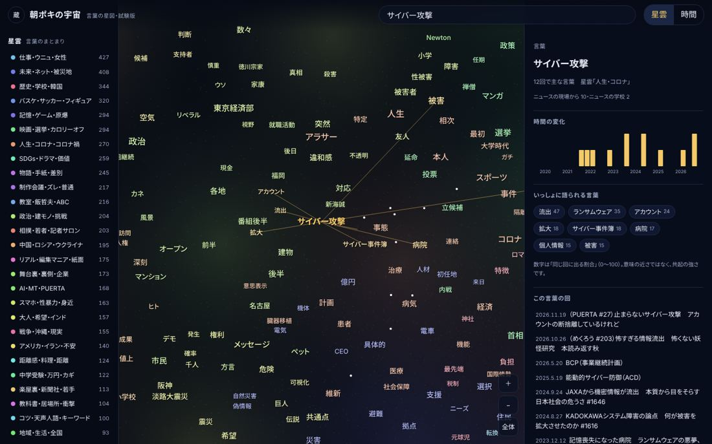
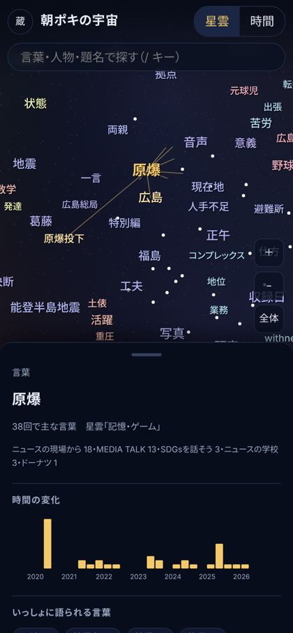
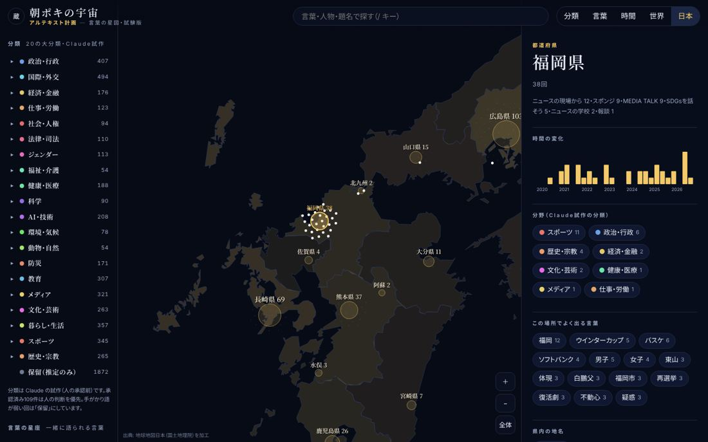
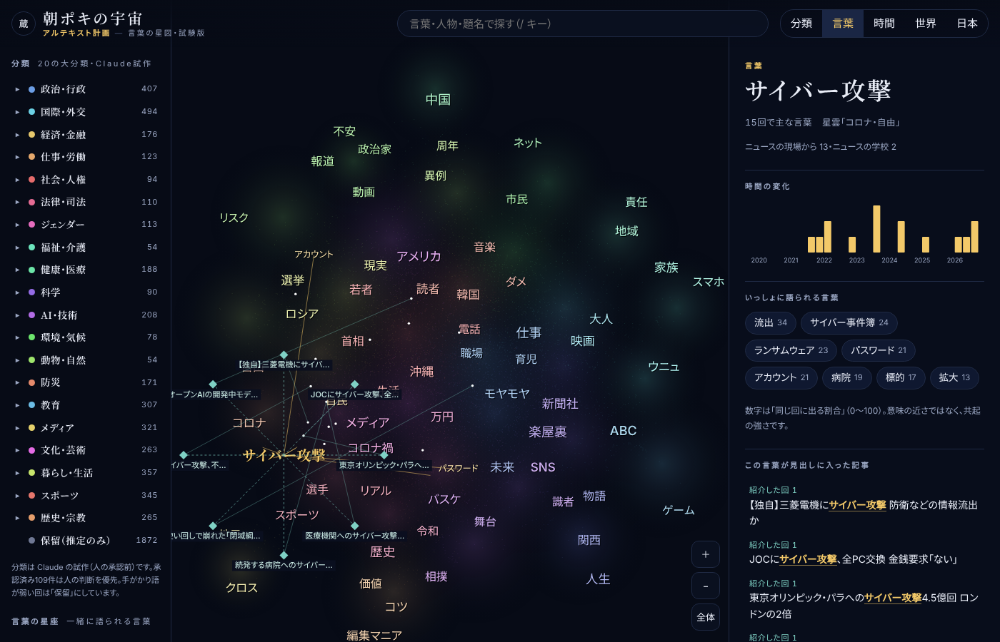
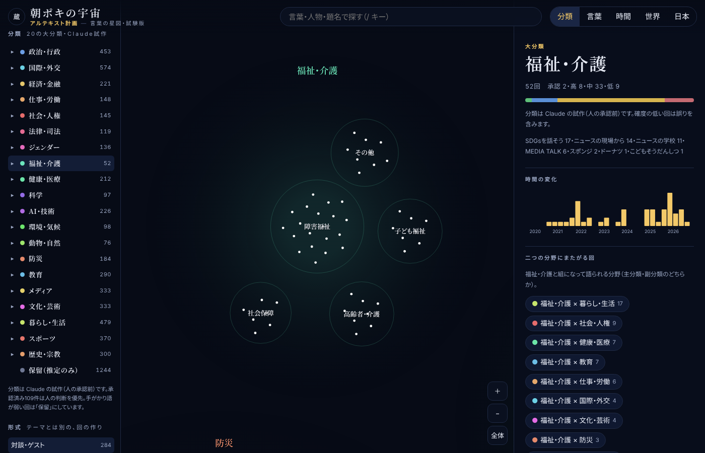
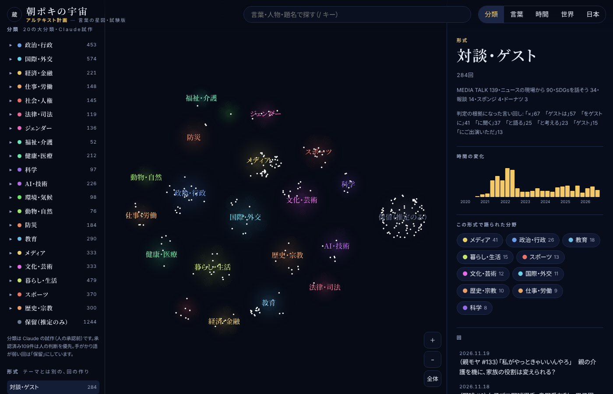

# アルテキスト計画｜朝ポキの宇宙「言葉の星図」最小試作（2026-11-19）

管理人指令「アルテキスト計画 — 世界最高水準の知識探索UI・ワードマッピング・リッチコンテンツ開発指令」（2026-11-19 13:59）への第1回の成果。
**独立した試験画面**（`/asarisunowa/uchu/`）として作り、既存の蔵・田・Spotify・GAS・V2台帳には一切書き込まない。main への統合と公開は管理人承認待ち。

## 1. 過去資産の監査（実装済み・試作済み・未着手）
| 資産 | 所在 | 状態 | 今回の扱い |
|---|---|---|---|
| 朝リスの宇宙 V0.11〜V0.12、Oceanic LAB、地図試作（test1024 系 10本） | 別リポ `asarisu-universe` main | **試作済み**。GitHub Pages 公開・実機確認は未確認と README に明記 | 画面構成（左カテゴリ・中央マップ・右詳細）を参考。コードは流用せず新設計 |
| 意味分類 5,358件（仮）・人の承認 109件・救出 200件・未回収 181件 | 同 `data/semantic-recovery`・work ブランチ | **試作済み（未承認）**。2026-11-14 棚卸し（docs/audits/2026-11-14-universe-inventory.md）と一致 | 今回は使わない（承認済み109件以外は仮のため）。将来「承認済み分類」の層として重ねる |
| 主20・小103 テーマ案 | 同 `lab-taxonomy-proposal-20261027.json` | **提案のみ**（承認0） | 使わない |
| テーマ橋渡し `theme-bridge-pilot.json` | 同 main | **試作済み・事故あり**（「本」1文字の正規表現で W杯→文学・美術 の誤判定。2026-10-25 是正記録） | 教訓として採用: 1文字・定型文での分類をしない／根拠を見せる |
| 地理 952EP・長野拡張・国際補完 | 同 `data/geo-*` | **試作済み** | 今回は対象外（第2回で地図表示に接続） |
| 関連記事の権利方針 | 同 `docs/related-article-rights-policy.md` | **方針あり** | 準拠: 記事本文は扱わない。見出しは蔵が既に公開している範囲を、その場で読んで表示するだけ（新しい写しを作らない） |
| 関連記事の見出し 13,466件／2話以上の記事 1,992本 | 田 #331・#334 | **蔵で公開済み**／言葉の地図化は提案のみ | 「同じ記事」を関連の根拠に使用（#334 提案 1・2 を実装） |
| 蔵書（自分の棚・共有URL） | 田 `public/library/shelf-core.mjs`（#315） | **実装済み** | 同じ保存形式をそのまま使い、星図から「蔵書に入れる」 |

## 2. 現行データの実測（蔵の公開データ 2026-11-19 版 a685240a）
- エピソード **6,090件**（8番組）。概要欄あり 6,081件（V2-clean 4,855／clean 622／V3 508／公式 95）、合計 **約134万字**、中央値155字。
- 出演者欄あり 6,087件 → 人物 **1,246人**（2回以上）。
- 関連記事URL 13,542件（5,113回）、異なり 10,459本、**2回以上で紹介された記事 1,991本**。
- 再生時間あり 6,077件。年別 2020:166／2021:729／2022:1,041／2023:960／2024:950／2025:1,145／2026:1,099。
- 旧分類の前提値（5,848件）は旧公開図書館の件数で、現行は 6,090件。

## 3. データモデル（ノードと関係）
- **ノード**: エピソード（星）／言葉（語彙 6,371語、うち地図に載る 2,926語）／人物（1,246人）／星雲（言葉のまとまり 32個）／記事（URLのみ。見出しは蔵から都度読む）。
- **関係（すべて根拠を保持）**
  1. 回―言葉: tf-idf 上位12語（題名は3倍の重み）
  2. 言葉―言葉: 同じ回の上位語に一緒に出る割合（共起の cosine。0〜100で表示）
  3. 回―回: 「共通の言葉」＋「同じ記事URL（1本 +0.6）」＋「同じ出演者（+0.25、150回超の常連は除く）」。上位5件、根拠の種類と中身を一緒に保存
  4. 同じ題名の回（再配信など）は推薦から外し、別枠で表示
- **意味と事実の区別**: 「同じ記事」「同じ出演者」は事実の一致、「共通の言葉」は統計。AI による意味の推測は今回ゼロ。画面にもそう明記。
- 出力: `public/uchu/data/core.json`（1.57MB／gzip 651KB）・`rel.json`（0.79MB／gzip 203KB）。回の本文・出演者・関連記事・再生先は蔵の `details/*.json` を必要な時だけ読む（写しを増やさない）。

## 4. 技術選定と根拠
| 候補 | 判断 | 理由 |
|---|---|---|
| 形態素解析（kuromoji 等） | **見送り（第2回で比較）** | 依存追加と辞書の維持が要る。漢字・カタカナ・英字の連続を1語とする方式で複合語（高次脳機能障害・サイバー攻撃・AI規制）がそのまま取れ、品質が十分。`Intl.Segmenter` は複合語を分解するため不採用 |
| Embedding による意味検索 | **見送り（要判断）** | 生成コスト・モデル更新時の互換・利用条件の確認が必要。今回は「根拠を見せる」ことを優先し、統計＋事実の一致に限定。導入時は「意味が近い」を別の根拠種別として足す |
| 共起グラフ＋ラベル伝播＋力学配置 | **採用** | 依存ゼロ・決定的（同じ入力で同じ地図。再実行で一致を確認）・計算 約3.4秒 |
| 描画 WebGL/deck.gl/Sigma.js/PixiJS | **見送り** | 6,090点は Canvas 2D で 1フレーム 16ms（60fps 上限）。依存を足す理由がない。10万点規模になったら WebGL を再検討 |
| UI フレームワーク | **素の HTML/CSS/JS（ES modules）** | 蔵と同じ流儀。ビルド不要、GitHub Pages に置くだけ |
| 事前計算の置き場 | GitHub（スクリプト）→ 静的 JSON | 蔵の公開データ更新に合わせて `node scripts/uchu/build-uchu.mjs` を回すだけ。Actions への組み込みは承認後 |

## 5. UI コンセプト「言葉の星図」
- **星＝回、星雲＝一緒に語られる言葉のまとまり、線＝根拠のある関係**。意味のない動きは入れない（移動・切替の補間だけ。動きを減らす設定では無効）。
- **3段の拡大（LOD）**: 遠景は星雲名 → 中景は言葉（回数の多い順に、重ならない分だけ）→ 近景は個々の星。
- **言葉を選ぶ**: その言葉の回だけが光る／近い言葉へ線と一覧／四半期ごとの棒グラフ（時間の変化）／番組の内訳／回の一覧。
- **回を選ぶ（リッチコンテンツ）**: 番組・日付・再生時間・概要欄・出演者・再生先（Spotify・Apple・Amazon 等。URLは蔵にあるものだけ）・この回の言葉・関連記事（見出しは蔵から）・**関連する回と「なぜ近いか」**（同じ記事 n件／同じ出演者／共通の言葉）・蔵で詳しく見る・蔵書に入れる。
- **時間の表示**: 横＝配信日、縦＝星雲。話題の帯が年ごとにどう濃くなるかを見る。
- 検索は言葉・人物・題名を同時に候補表示。URL の `#w=言葉` `#e=EP-ID` `#p=人物` で状態を共有できる。

## 6. 実データで動く最小試作
- `public/uchu/index.html`・`uchu.css`・`uchu.mjs`（外部ライブラリなし）
- `scripts/uchu/uchu-core.mjs`（取り出しの純関数）・`scripts/uchu/build-uchu.mjs`（事前計算）
- `tests/uchu-core.test.mjs`（取り出し規則6件＋データの参照整合）

例: 「（1on1）蚊取り線香はツッコミ待ちだった　寺下真理加さん」→ 関連に寺下真理加さんの他の 1on1 回が「同じ出演者: 寺下真理加・共通の言葉: 1on1」の根拠つきで並ぶ。「サイバー攻撃」→ 近い言葉に 流出47・ランサムウェア35・アカウント24・個人情報15。

## 7. 性能・アクセシビリティの評価（Chrome・Playwright で実測）
| 項目 | 結果 |
|---|---|
| core.json 読込 | 35〜97ms（手元サーバー。Pages では gzip 651KB の転送が加わる） |
| 操作可能になるまで | 77〜135ms（読込後） |
| 検索候補の表示 | 約4ms（6,090題名＋6,371語＋1,246人） |
| 描画 | 1フレーム 約16ms（60fps 上限で頭打ち） |
| 事前計算 | 約3.4秒、決定的 |
| エラー | なし（favicon の 404 のみ） |
- **キーボード**: `/` で検索、↑↓＋Enter で選択、選択後は詳細へフォーカス移動、Tab で操作。星図自体も矢印で移動・＋−で拡大・Enter で中央の星を選択。
- **読み上げ**: 選択結果を `aria-live` で通知。星図は補助とし、同じ情報を一覧・検索から使える。棒グラフは SVG に件数の説明つき。
- **動きを減らす**設定で補間をすべて無効化。スマホは下からの詳細シート、ピンチ拡大、選んだ星はシートに隠れない位置へ。
- 未確認: 実機のスマホ（iOS Safari）・スクリーンリーダー実機・GitHub Pages 上での転送時間。

## 8. 既知の限界と次の一歩
- 星雲の名前は自動の仮名で、混ざったまとまり（例「映画・選挙」）がある。**承認済み分類109件**や人の命名を重ねる層が次の候補。
- 地図に載らない回が42件（共通の言葉が少ない）。無理に置かず「配置なし」と表示。
- 「同じ名前の別人」は区別できていない（画面に注記）。
- 第2回の候補: ①地理（宇宙リポの952EP）を地図表示に接続 ②形態素解析・Embedding を小さく比較し、根拠の種別として追加 ③蔵の日次更新に合わせた自動再計算（Actions）④人の確認で星雲名・分類を確定する画面。

## 守ったこと
- 蔵・V2台帳・GAS・Spotify・既存画面は変更なし。新規ファイルのみ。
- URL を作らない（再生先・記事は蔵のデータにあるものだけ）。記事本文は扱わない。
- 元データにない内容を事実として書かない（説明文は概要欄の原文のみ）。

---

## 追補（同日 14:47 管理人「実際の分類も Claude に試作は任せます」）: 20大分類・小分類
- **体系**: asarisu-universe の提案（20主・約100小、PROPOSAL_ONLY）を土台に、20大分類・86小分類として `scripts/uchu/taxonomy.mjs` に定義。手がかり語はすべて2文字以上（10/25「本」事故の再発防止。テストで検査）。
- **判定の順序**（`scripts/uchu/classify.mjs`）
  1. 人の承認109件: 大分類は承認に従う（確度＝承認）。
  2. 旧仮分類が「大/小」形式の回（300件）: その大分類を使い、手がかり語で一致すれば確度 高、無ければ 中。
  3. それ以外: 題名（×3）・旧仮分類の主題文（×2.5）・関連記事の見出し（×1.5）・概要欄（×1。番組共通の案内文は除く）の手がかり語の得点。得点と2位との差で 高／中／低。
  4. 決まらない回: 高確度の回から学んだ単純ベイズ、または関連回の多数決で**推定だけ**を残し、分類には置かず「保留」。
- **結果**: 分類に置いた回 4,218（承認109・高1,445・中1,263・低1,401）、保留 1,872（推定あり 1,812・推定なし 60）。
- **精度の目安**（承認109件で、旧分類を見ずに手がかり語だけで判定）: 判定できたのは76件、そのうち承認と一致は55件（72%）。単純ベイズのみだと109件中62件（57%）。抜き取り20件の目視でも、高・中はおおむね妥当、学習による推定は外れが目立つ（例: 新海誠の映画→防災）ため保留に回した。
- **画面**: 「分類」表示を最初に表示。大分類＝色の領域、小分類＝その中の円、回＝ひまわり配置（新しい回ほど中心）。左は20大分類の木（開くと小分類）。回の詳細に「分類・確度・根拠の語と欄・旧仮分類」を表示。時間の表示の縦軸も大分類に。
- **限界と次**: 統計と辞書の上限は7割前後。精度を上げるには (a) Claude が各回を読んで判定する（6,090件で大きな作業量）か、(b) 人が保留と低確度を確認する画面、のどちらか。V2台帳への反映は人の承認後。

---

## 追補（同日 15:11 管理人「世界地図、日本地図バージョン」）
- **地図の形**: 世界は Natural Earth 由来の johan/world.geo.json（パブリックドメイン）、日本は dataofjapan/land の都道府県境（出典: 地球地図日本〈国土地理院〉。非営利は出典明記で利用可。画面に明記）。`scripts/uchu/build-geo.mjs` で簡略化し、世界89KB・日本90KB。
- **図法**: 世界は Equal Earth（面積の比が正しい）、日本は日本付近のメルカトル。
- **地名の取り出し**（`scripts/uchu/gazetteer.mjs`・`geo.mjs`。Claude 作成の試作）: 47都道府県（座標は県庁所在地）・日本の地名約60・国と主要都市約110。題名×3・旧仮分類の主題文×2.5・関連記事の見出し×1.5・概要欄×1（案内文を除く）。
  - 紛れの除外: 2文字の地名に漢字が続くもの（「石川佳純」「宮崎駿」）、「さん・記者・選手」などが続くもの（「福島さん」）、カタカナ語の一部（「インドネシア」の中の「インド」）、「中国地方」。1文字の地名は置かない（テストで検査）。
- **結果**: 地名のある回 2,911（日本 1,806・海外 1,384）。多い順に 大阪・アメリカ・東京・中国・沖縄・ロシア・京都・広島・ウクライナ・韓国。地名の無い回は地図に置かない。
- **画面**: 「世界」「日本」の表示を追加。国・都道府県を回の数で塗り分け、地名ごとに円（大きさ＝回数）と星（色＝分類）。地名を選ぶと、回数・時間の変化・分野の内訳・その場所でよく出る言葉・県内の地名・一緒に語られる場所・回の一覧。回の詳細にも「場所」（根拠の欄つき）。
- **限界**: 辞書にない地名は拾わない。同名の地名（例: 府中）や比喩の区別は前後の文字だけで、誤りを含む。

---

## 追補（同日 16:39 管理人がiPhoneで確認）: 読み込み・案内の×・関連記事
- **案内の×で閉じない不具合**: `.toast { display:flex }` が `hidden` 属性より優先され、閉じても表示が残っていた（読み込み中に空の×だけの箱が出ていたのも同じ原因）。`[hidden]{display:none !important}` で修正。Chrome（Playwright・iPhone相当の画面）で×で閉じることを確認。
- **読み込みの2段化**: 以前は 2.2MB（圧縮後 約0.8MB）を全部読んでから表示。いまは
  1. `core.json` 0.94MB（圧縮後 約0.37MB）: 回・分類・星雲 → これだけで「分類」表示を出す
  2. `extra.json` 1.65MB（言葉・人物・地名・分類の根拠・記事）と `rel.json` 0.82MB（関連回）は裏で
  - 進み具合: 最初は中央の棒（％と MB）、表示後は上の細い棒「言葉・地図・関連回を読み込み中 ◯%」。`manifest.json` に圧縮前の大きさを置き、受け取った量から％を出す。
  - 回線 600KB/s・圧縮なしの模擬で、表示まで 2.3秒、全部そろうまで 6.4秒（実際のサイトは圧縮されるのでもっと速い）。
  - 世界・日本の地図は2段目が届いてから切り替える（押した時点で未着なら、届き次第切り替え）。
- **関連記事の見出しも「在るテキスト」に**: 言葉の取り出しに関連記事の見出しを追加（語彙 6,371→9,174語）。最初の案内文に「題名・概要欄・関連記事の見出し」を明記。
- **関連記事の見せ方**: 回の詳細に関連記事を全本数表示し、2回以上で紹介された記事には「この記事を紹介した回 n」。押すとその記事を紹介した回の一覧。最初の案内に「多くの回で紹介された記事」（上位30本）。2回以上で紹介された記事は 2,007本。見出しは蔵のデータからその場で読む（新しい写しは作らない）。

## 追補（同日 18:15 管理人「①を実装　別イシューで頼む」）: 言葉から記事へ（#384）

- 言葉を選ぶと、詳細に「この言葉が見出しに入った記事」を出す。紹介した回の多い順に最大12本。見出しの中の言葉に金色の印をつける。押すとその記事と紹介した回へ。
- 「言葉」の表示では、選んだ言葉のまわりに上位8本を ◆ で置き、紹介した回の星と線で結ぶ。◆ も押せる。
- データ: `public/uchu/data/articles/index.json`（言葉→記事番号、gzip 約70KB）と `s0〜s31.json`（見出し・紹介した回、各 gzip 約21KB）。言葉を初めて選んだときに索引を読み、必要な分のファイルだけ読む。最初の表示の速さは変わらない。
- 扱うのは蔵で公開済みの見出しと URL だけ。記事本文は読まない・載せない。言葉と記事のつながりは「見出しにその言葉が入っている」という事実だけで、AI の推測は入れていない。
- 試験: 索引の言葉が実際に見出しから取り出せること、紹介回数順であることを確かめる（tests/uchu-core.test.mjs）。

## 追補（同日 19:02 管理人「概要欄清掃必要ネタ発見」）: 概要欄の定型文を除く

- #180（ハチの新種）の概要欄の末尾に、番組宣伝の定型文（「ニュースの現場から」「MEDIA TALK」…「の7番組を配信中です」）と「※この番組は…収録しました」が入っていた。甲子園・就活・英語などの番組名が、内容とは関係なく言葉の材料になっていた。
- 対応: 言葉の星図・分類・地名に使う前に、①番組一覧の宣伝文 ②※・★で始まる注記（収録日・告知・紹介したポッドキャスト名など）を次の句点まで取り除く。6,081件の概要欄のうち4,179件で何かしら取り除かれ、内容まで消えた例はないことを確認した。蔵の元データ（概要欄の原文）は変えていない。
- 言葉の数は 9,174 → 8,916（定型文だけに出ていた言葉が消えた）。
- #180 は辞書に「新種」が無かったため保留だった。「新種」を 動物・自然／植物・生態系 に足し、確定した。

## 追補（同日 19:44 管理人「①辞書改善…進めてよい」）: 辞書の見直しと公式タグ

- 保留の回に多い言葉を数え、意味がはっきりしたものだけ辞書に足した（育児・家事・観光客・農家・坐禅・禅寺・釈尊・漫画家・図書館・ヒップホップ・懐メロ・食文化・方言・ご当地・韓国語・自由研究・宿題・小学生・政治家・民主主義・ルッキズム・武士、ほか前回の新種）。「未来」「言葉」「人生」のような広すぎる言葉は足していない。
- 蔵の元データにある公式タグ（朝日新聞側が付けたもの。例: 動植物・働き方・ジェンダー）を、大分類の手がかりに加えた（重み3、題名の手がかり語1つ分）。番組名・人名・意味の広いタグ（SDGs、IT・科学、災害・交通 など）は使わない。根拠欄には「蔵の公式タグ」と出る。
- 結果: 保留（学習推定・近い回・未分類）1,881回 → 1,756回。確度「高」1,440 → 1,622回。承認済みの回での目隠し一致 55/76 → 56/77（下がっていない）。
- 残った保留は「笑い飯哲夫のしんぶん教室」「楽屋裏」のように、題名から分野が決めにくい回が中心。人の判断が向いている（仕分けの試作は別 Issue）。

## 追補（同日 21:09 管理人「笑い飯哲夫の番組の概要欄チェック…清掃とテーマ抽出」）: 番組ごとの清掃

- 哲夫さんの出演回 133回を網羅（しんぶん教室 125回、ほかは「笑い飯・哲夫さんに聞く」2回と、別人の小暮哲夫記者の回 5回）。
- しんぶん教室の概要欄は毎回同じ前置き（「大阪ABCラジオ『笑い飯哲夫のしんぶん教室』をノーカットで…お子さんに朝日新聞の記事を説明する番組です」）、パーソナリティ、子どもゲスト（名前・都道府県・学年）、公式HP・メールアドレスが並ぶ。この前置きの「大阪」で100回が大阪府に、題名の「教室」で76回が教育に入っていた。
- 本当のテーマは「○月○日付朝刊『（見出し）』の記事を取り上げました」の見出し。109回で取り出せた（残りは沖縄・熊本の出張回や新聞の読み方講座などの特別回で、題名と本文がテーマを表している）。
- 対応: `scripts/uchu/series.mjs` を新設。番組ごとに「題名から除く番組名」「概要欄から除く定型文」「テーマとなる見出しの取り出し方」を表で持ち、言葉・分類・地名の前に適用する（蔵の原文は変えない）。番組をまたぐ定型（URL・メール・イベント告知・【関連記事】の繰り返し）も除く。取り出した見出しは題名と同じ重みで使う。今後ほかの番組も同じ表に足せる。
- 子どもゲスト（出演欄に学年がある人）と都道府県名は人物の星にしない。
- 「建物」を建築の手がかり語から外し（広すぎる）、子ども向けニュースに多い言葉（埴輪・木簡・恐竜・化石・衛星・コアラ・高校野球・大リーグ・気象庁・消費期限・著作権・児童労働 など）を足した。
- 結果（しんぶん教室）: 教育 76回 → 17回で、文化・芸術、歴史・宗教、科学、スポーツ、動物・自然などへ分かれた。大阪府 100回 → 4回（記事の舞台が大阪の回だけ）。全体の保留は 1,756 → 1,737、承認済みでの目隠し一致は 56/77 のまま。

## 追補（同日 21:41 管理人「主分類と副分類」「形式の軸」— #390）

### 主分類＋副分類
- 手がかり語の点数で上位二つの分野がどちらも2.5点以上（主分類の1.6倍に届かない）なら、主分類と副分類の両方を付ける。同点のときは題名に根拠がある分野を主にする。
- すでに決まっている回でも、ほかの分野に3点以上・主分類の半分以上の根拠があれば副分類にする。人の承認（user_approved）の大分類は動かさない。
- 回の詳細に「副分類」と、その根拠の言葉を出す。大分類を選ぶと「二つの分野にまたがる回」（例: 福祉・介護 × 暮らし・生活 17回）と、副分類としてそこに入る回の一覧が出る。
- 結果: 保留 1,737 → 1,244回。副分類のある回 1,884回。承認済みでの目隠し一致は主分類で 58/79、副分類まで含めると 63/79。

### 形式の軸
- `scripts/uchu/format.mjs`。題名・概要欄の決まった言い回しで判定（推測しない、1回に複数可）。対談・ゲスト 284／番組づくり・舞台裏 227／新聞めくり 224／お便り・相談 202／子ども向け 179／ニュースチャット 154／公開収録・イベント 103／振り返り・まとめ 48／朗読 34。計1,552回、うち保留の回が458回。
- 左の欄に「形式」を追加。選ぶと、判定の根拠になった言い回し、番組の内訳、時間の変化、この形式で語られた分野、回の一覧が出る。回の詳細にも形式と根拠を出す。URL は `#f=番号`。
- 最初の読み込み（core.json）は 943KB → 1,031KB（転送 372KB → 385KB）。

## 追補（同日 22:02）: 副分類と形式の品質監査（#390）

方法: 抜き出しは乱数の種を固定（副分類 390・形式 391・再確認 777）。Claude が題名と概要欄を読んで判定（○正しい／△どちらとも／×誤り）。

### 副分類（根拠の種類ごとに25回ずつ、計100回）
| 根拠の種類 | 該当 | ○ | △ | × | 主な誤り |
|---|---|---|---|---|---|
| 題名に根拠あり | 1,069 | 19 | 1 | 5 | 「ペットボトル」→ペット、「テレビ塔」→テレビ、「理論」→科学、「おすすめ」→趣味 |
| 関連記事の見出しだけ | 221 | 10 | 5 | 10 | 本題と関係の薄い記事の言葉（食中毒の回に「ライブ」「建築」） |
| 公式タグだけ | 90 | 17 | 3 | 5 | 「社会」「働き方」「経済」など意味の広いタグ |
| その他（複数の欄） | 504 | 20 | 2 | 3 | 旧仮分類の「歴史」、「パン」（ブータン→ジャパン） |

対応:
- 3文字以下のカタカナ語は、前後がカタカナでないときだけ当てる（パン／ジャパン、ペット／ペットボトル）。「テレビ塔」は照合前に消す。「おすすめ」「理論」を手がかり語から外す。
- 副分類の根拠が「関連記事の見出しだけ」または「意味の広い公式タグだけ」のときは付けない。
- 再確認: 監査で×だった副分類 23件のうち 20件が外れた。○だった 66件のうち 51件は残った（外れた15件は主に記事だけ・タグだけの回）。残った副分類の正答は抜き出しの範囲で約94%（○51／×3）。
- 副分類のある回 1,884 → 1,564回。承認済みでの目隠し一致 主 56/77、副まで 61/77。

### 形式（各形式18回前後、計約150回）
| 形式 | 修正前の正答の目安 | 主な誤検出 | 対応 |
|---|---|---|---|
| 対談・ゲスト | 約92% | 「イベントのゲストも発表」 | 「ゲストも発表」を除外 |
| お便り・相談 | 約40〜60% | 告知「★空気階段に悩みを相談しよう★」、ニュースレター名「朝ポキおたより」、「同じ質問を別の人に」 | リスナー・読者からの便りに限る。★…★の告知を除去 → 再確認で約85% |
| 振り返り・まとめ | 約83% | 「母の日ふりかえり」「1年を振り返」 | 月刊朝ポキ・総集編などに限定 |
| 新聞めくり | 約89% | めくろうメンバーが出た別の回 | 「一緒に新聞をめくろう」の後に「メンバー」「MC」「同窓会」が続くものを除外 |
| 番組づくり | ほぼ100% | （楽屋裏はスタッフの雑談回） | 名前を「番組づくり・スタッフトーク」に |
| ニュースチャット | 約86% | 予告や番組情報の中の「1on1」 | 冒頭の決まり文句に限定 |
| 朗読 | 約78% | 「詩を朗読する和合亮一さん」（話題として） | 「朗読とともに」「朗読劇」などに限定 |
| 子ども向け | 題名判定は低い | 「こどものまち」「こどものSNS」（話題） | 題名の「こども」を使わず、番組・シリーズ・子どもゲストだけ |
| 公開収録・イベント | 約17% | 概要欄冒頭のイベント告知文（2024年2月2日の公開収録など） | 告知文を除去し、題名の決まった言い方に限定。告知回も含むため名前を「公開収録・イベント関連」に → 103回 → 23回 |

形式の回数（修正後）: 対談・ゲスト 281／番組づくり・スタッフトーク 267／新聞めくり 200／お便り・相談 170／子ども向け 169／ニュースチャット 127／振り返り・まとめ 44／朗読 26／公開収録・イベント関連 23

### 残る課題
- 人による抜き取り確認（Claude の判定そのものの誤りを見るため、迷った回を管理人に）
- 副分類の「△」（どちらとも言える）の扱い
