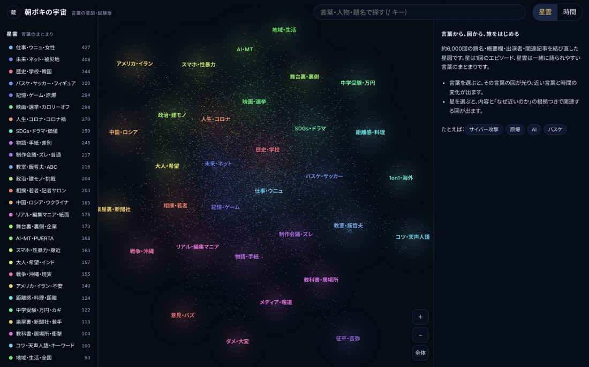
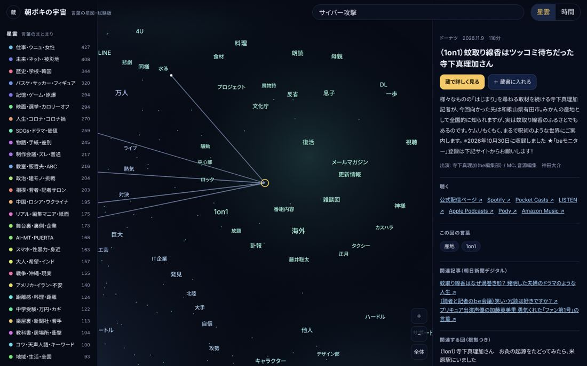
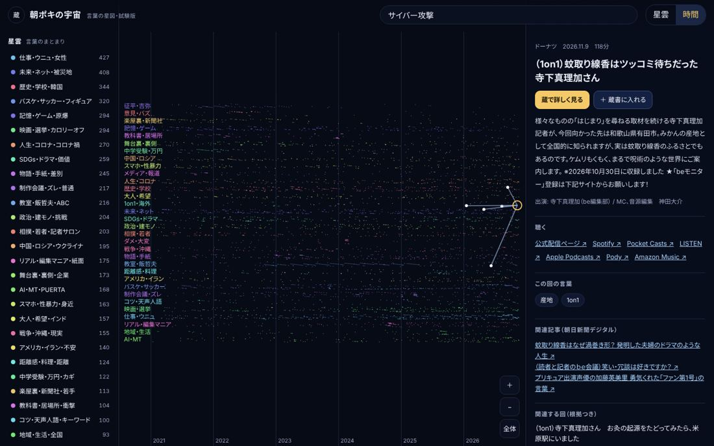
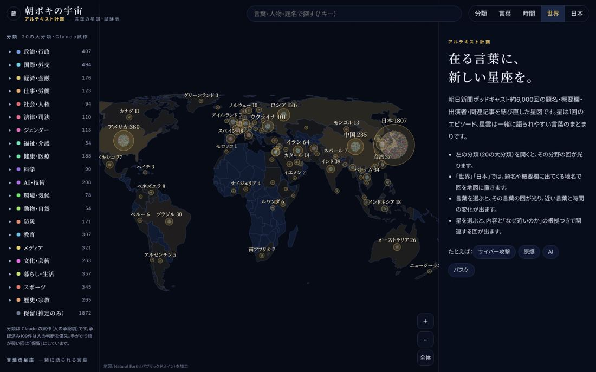
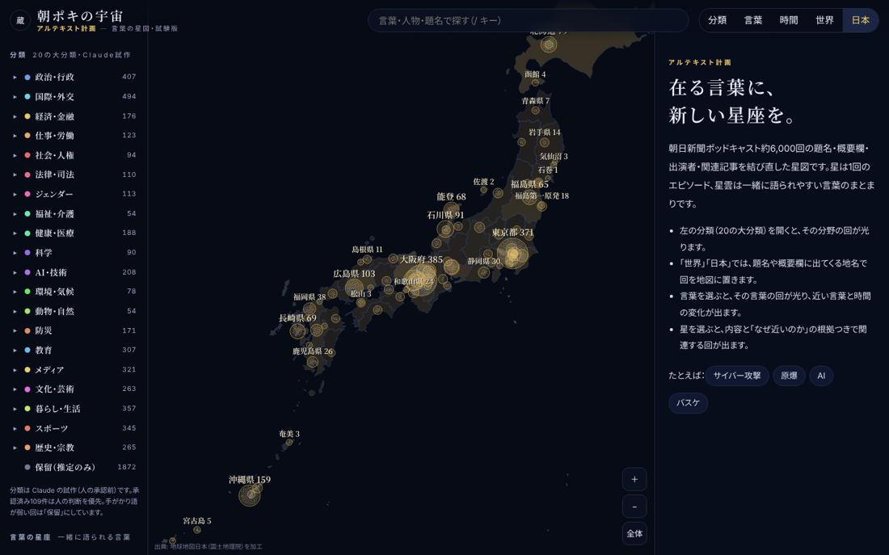

# アルテキスト計画｜朝ポキの宇宙「言葉の星図」最小試作（2026-11-19）

管理人指令「アルテキスト計画 — 世界最高水準の知識探索UI・ワードマッピング・リッチコンテンツ開発指令」（2026-11-19 13:59）への第1回の成果。
**独立した試験画面**（`/asarisunowa/uchu/`）として作り、既存の蔵・田・Spotify・GAS・V2台帳には一切書き込まない。main への統合と公開は管理人承認待ち。

## 1. 過去資産の監査（実装済み・試作済み・未着手）
| 資産 | 所在 | 状態 | 今回の扱い |
|---|---|---|---|
| 朝リスの宇宙 V0.11〜V0.12、Oceanic LAB、地図試作（test1024 系 10本） | 別リポ `asarisu-universe` main | **試作済み**。GitHub Pages 公開・実機確認は未確認と README に明記 | 画面構成（左カテゴリ・中央マップ・右詳細）を参考。コードは流用せず新設計 |
| 意味分類 5,358件（仮）・人の承認 109件・救出 200件・未回収 181件 | 同 `data/semantic-recovery`・work ブランチ | **試作済み（未承認）**。2026-11-14 棚卸し（docs/audits/2026-11-14-universe-inventory.md）と一致 | 今回は使わない（承認済み109件以外は仮のため）。将来「承認済み分類」の層として重ねる |
| 主20・小103 テーマ案 | 同 `lab-taxonomy-proposal-20261027.json` | **提案のみ**（承認0） | 使わない |
| テーマ橋渡し `theme-bridge-pilot.json` | 同 main | **試作済み・事故あり**（「本」1文字の正規表現で W杯→文学・美術 の誤判定。2026-10-25 是正記録） | 教訓として採用: 1文字・定型文での分類をしない／根拠を見せる |
| 地理 952EP・長野拡張・国際補完 | 同 `data/geo-*` | **試作済み** | 今回は対象外（第2回で地図表示に接続） |
| 関連記事の権利方針 | 同 `docs/related-article-rights-policy.md` | **方針あり** | 準拠: 記事本文は扱わない。見出しは蔵が既に公開している範囲を、その場で読んで表示するだけ（新しい写しを作らない） |
| 関連記事の見出し 13,466件／2話以上の記事 1,992本 | 田 #331・#334 | **蔵で公開済み**／言葉の地図化は提案のみ | 「同じ記事」を関連の根拠に使用（#334 提案 1・2 を実装） |
| 蔵書（自分の棚・共有URL） | 田 `public/library/shelf-core.mjs`（#315） | **実装済み** | 同じ保存形式をそのまま使い、星図から「蔵書に入れる」 |

## 2. 現行データの実測（蔵の公開データ 2026-11-19 版 a685240a）
- エピソード **6,090件**（8番組）。概要欄あり 6,081件（V2-clean 4,855／clean 622／V3 508／公式 95）、合計 **約134万字**、中央値155字。
- 出演者欄あり 6,087件 → 人物 **1,246人**（2回以上）。
- 関連記事URL 13,542件（5,113回）、異なり 10,459本、**2回以上で紹介された記事 1,991本**。
- 再生時間あり 6,077件。年別 2020:166／2021:729／2022:1,041／2023:960／2024:950／2025:1,145／2026:1,099。
- 旧分類の前提値（5,848件）は旧公開図書館の件数で、現行は 6,090件。

## 3. データモデル（ノードと関係）
- **ノード**: エピソード（星）／言葉（語彙 6,371語、うち地図に載る 2,926語）／人物（1,246人）／星雲（言葉のまとまり 32個）／記事（URLのみ。見出しは蔵から都度読む）。
- **関係（すべて根拠を保持）**
  1. 回―言葉: tf-idf 上位12語（題名は3倍の重み）
  2. 言葉―言葉: 同じ回の上位語に一緒に出る割合（共起の cosine。0〜100で表示）
  3. 回―回: 「共通の言葉」＋「同じ記事URL（1本 +0.6）」＋「同じ出演者（+0.25、150回超の常連は除く）」。上位5件、根拠の種類と中身を一緒に保存
  4. 同じ題名の回（再配信など）は推薦から外し、別枠で表示
- **意味と事実の区別**: 「同じ記事」「同じ出演者」は事実の一致、「共通の言葉」は統計。AI による意味の推測は今回ゼロ。画面にもそう明記。
- 出力: `public/uchu/data/core.json`（1.57MB／gzip 651KB）・`rel.json`（0.79MB／gzip 203KB）。回の本文・出演者・関連記事・再生先は蔵の `details/*.json` を必要な時だけ読む（写しを増やさない）。

## 4. 技術選定と根拠
| 候補 | 判断 | 理由 |
|---|---|---|
| 形態素解析（kuromoji 等） | **見送り（第2回で比較）** | 依存追加と辞書の維持が要る。漢字・カタカナ・英字の連続を1語とする方式で複合語（高次脳機能障害・サイバー攻撃・AI規制）がそのまま取れ、品質が十分。`Intl.Segmenter` は複合語を分解するため不採用 |
| Embedding による意味検索 | **見送り（要判断）** | 生成コスト・モデル更新時の互換・利用条件の確認が必要。今回は「根拠を見せる」ことを優先し、統計＋事実の一致に限定。導入時は「意味が近い」を別の根拠種別として足す |
| 共起グラフ＋ラベル伝播＋力学配置 | **採用** | 依存ゼロ・決定的（同じ入力で同じ地図。再実行で一致を確認）・計算 約3.4秒 |
| 描画 WebGL/deck.gl/Sigma.js/PixiJS | **見送り** | 6,090点は Canvas 2D で 1フレーム 16ms（60fps 上限）。依存を足す理由がない。10万点規模になったら WebGL を再検討 |
| UI フレームワーク | **素の HTML/CSS/JS（ES modules）** | 蔵と同じ流儀。ビルド不要、GitHub Pages に置くだけ |
| 事前計算の置き場 | GitHub（スクリプト）→ 静的 JSON | 蔵の公開データ更新に合わせて `node scripts/uchu/build-uchu.mjs` を回すだけ。Actions への組み込みは承認後 |

## 5. UI コンセプト「言葉の星図」
- **星＝回、星雲＝一緒に語られる言葉のまとまり、線＝根拠のある関係**。意味のない動きは入れない（移動・切替の補間だけ。動きを減らす設定では無効）。
- **3段の拡大（LOD）**: 遠景は星雲名 → 中景は言葉（回数の多い順に、重ならない分だけ）→ 近景は個々の星。
- **言葉を選ぶ**: その言葉の回だけが光る／近い言葉へ線と一覧／四半期ごとの棒グラフ（時間の変化）／番組の内訳／回の一覧。
- **回を選ぶ（リッチコンテンツ）**: 番組・日付・再生時間・概要欄・出演者・再生先（Spotify・Apple・Amazon 等。URLは蔵にあるものだけ）・この回の言葉・関連記事（見出しは蔵から）・**関連する回と「なぜ近いか」**（同じ記事 n件／同じ出演者／共通の言葉）・蔵で詳しく見る・蔵書に入れる。
- **時間の表示**: 横＝配信日、縦＝星雲。話題の帯が年ごとにどう濃くなるかを見る。
- 検索は言葉・人物・題名を同時に候補表示。URL の `#w=言葉` `#e=EP-ID` `#p=人物` で状態を共有できる。

## 6. 実データで動く最小試作
- `public/uchu/index.html`・`uchu.css`・`uchu.mjs`（外部ライブラリなし）
- `scripts/uchu/uchu-core.mjs`（取り出しの純関数）・`scripts/uchu/build-uchu.mjs`（事前計算）
- `tests/uchu-core.test.mjs`（取り出し規則6件＋データの参照整合）

例: 「（1on1）蚊取り線香はツッコミ待ちだった　寺下真理加さん」→ 関連に寺下真理加さんの他の 1on1 回が「同じ出演者: 寺下真理加・共通の言葉: 1on1」の根拠つきで並ぶ。「サイバー攻撃」→ 近い言葉に 流出47・ランサムウェア35・アカウント24・個人情報15。

## 7. 性能・アクセシビリティの評価（Chrome・Playwright で実測）
| 項目 | 結果 |
|---|---|
| core.json 読込 | 35〜97ms（手元サーバー。Pages では gzip 651KB の転送が加わる） |
| 操作可能になるまで | 77〜135ms（読込後） |
| 検索候補の表示 | 約4ms（6,090題名＋6,371語＋1,246人） |
| 描画 | 1フレーム 約16ms（60fps 上限で頭打ち） |
| 事前計算 | 約3.4秒、決定的 |
| エラー | なし（favicon の 404 のみ） |
- **キーボード**: `/` で検索、↑↓＋Enter で選択、選択後は詳細へフォーカス移動、Tab で操作。星図自体も矢印で移動・＋−で拡大・Enter で中央の星を選択。
- **読み上げ**: 選択結果を `aria-live` で通知。星図は補助とし、同じ情報を一覧・検索から使える。棒グラフは SVG に件数の説明つき。
- **動きを減らす**設定で補間をすべて無効化。スマホは下からの詳細シート、ピンチ拡大、選んだ星はシートに隠れない位置へ。
- 未確認: 実機のスマホ（iOS Safari）・スクリーンリーダー実機・GitHub Pages 上での転送時間。

## 8. 既知の限界と次の一歩
- 星雲の名前は自動の仮名で、混ざったまとまり（例「映画・選挙」）がある。**承認済み分類109件**や人の命名を重ねる層が次の候補。
- 地図に載らない回が42件（共通の言葉が少ない）。無理に置かず「配置なし」と表示。
- 「同じ名前の別人」は区別できていない（画面に注記）。
- 第2回の候補: ①地理（宇宙リポの952EP）を地図表示に接続 ②形態素解析・Embedding を小さく比較し、根拠の種別として追加 ③蔵の日次更新に合わせた自動再計算（Actions）④人の確認で星雲名・分類を確定する画面。

## 守ったこと
- 蔵・V2台帳・GAS・Spotify・既存画面は変更なし。新規ファイルのみ。
- URL を作らない（再生先・記事は蔵のデータにあるものだけ）。記事本文は扱わない。
- 元データにない内容を事実として書かない（説明文は概要欄の原文のみ）。

---

## 追補（同日 14:47 管理人「実際の分類も Claude に試作は任せます」）: 20大分類・小分類
- **体系**: asarisu-universe の提案（20主・約100小、PROPOSAL_ONLY）を土台に、20大分類・86小分類として `scripts/uchu/taxonomy.mjs` に定義。手がかり語はすべて2文字以上（10/25「本」事故の再発防止。テストで検査）。
- **判定の順序**（`scripts/uchu/classify.mjs`）
  1. 人の承認109件: 大分類は承認に従う（確度＝承認）。
  2. 旧仮分類が「大/小」形式の回（300件）: その大分類を使い、手がかり語で一致すれば確度 高、無ければ 中。
  3. それ以外: 題名（×3）・旧仮分類の主題文（×2.5）・関連記事の見出し（×1.5）・概要欄（×1。番組共通の案内文は除く）の手がかり語の得点。得点と2位との差で 高／中／低。
  4. 決まらない回: 高確度の回から学んだ単純ベイズ、または関連回の多数決で**推定だけ**を残し、分類には置かず「保留」。
- **結果**: 分類に置いた回 4,218（承認109・高1,445・中1,263・低1,401）、保留 1,872（推定あり 1,812・推定なし 60）。
- **精度の目安**（承認109件で、旧分類を見ずに手がかり語だけで判定）: 判定できたのは76件、そのうち承認と一致は55件（72%）。単純ベイズのみだと109件中62件（57%）。抜き取り20件の目視でも、高・中はおおむね妥当、学習による推定は外れが目立つ（例: 新海誠の映画→防災）ため保留に回した。
- **画面**: 「分類」表示を最初に表示。大分類＝色の領域、小分類＝その中の円、回＝ひまわり配置（新しい回ほど中心）。左は20大分類の木（開くと小分類）。回の詳細に「分類・確度・根拠の語と欄・旧仮分類」を表示。時間の表示の縦軸も大分類に。
- **限界と次**: 統計と辞書の上限は7割前後。精度を上げるには (a) Claude が各回を読んで判定する（6,090件で大きな作業量）か、(b) 人が保留と低確度を確認する画面、のどちらか。V2台帳への反映は人の承認後。

---

## 追補（同日 15:11 管理人「世界地図、日本地図バージョン」）
- **地図の形**: 世界は Natural Earth 由来の johan/world.geo.json（パブリックドメイン）、日本は dataofjapan/land の都道府県境（出典: 地球地図日本〈国土地理院〉。非営利は出典明記で利用可。画面に明記）。`scripts/uchu/build-geo.mjs` で簡略化し、世界89KB・日本90KB。
- **図法**: 世界は Equal Earth（面積の比が正しい）、日本は日本付近のメルカトル。
- **地名の取り出し**（`scripts/uchu/gazetteer.mjs`・`geo.mjs`。Claude 作成の試作）: 47都道府県（座標は県庁所在地）・日本の地名約60・国と主要都市約110。題名×3・旧仮分類の主題文×2.5・関連記事の見出し×1.5・概要欄×1（案内文を除く）。
  - 紛れの除外: 2文字の地名に漢字が続くもの（「石川佳純」「宮崎駿」）、「さん・記者・選手」などが続くもの（「福島さん」）、カタカナ語の一部（「インドネシア」の中の「インド」）、「中国地方」。1文字の地名は置かない（テストで検査）。
- **結果**: 地名のある回 2,911（日本 1,806・海外 1,384）。多い順に 大阪・アメリカ・東京・中国・沖縄・ロシア・京都・広島・ウクライナ・韓国。地名の無い回は地図に置かない。
- **画面**: 「世界」「日本」の表示を追加。国・都道府県を回の数で塗り分け、地名ごとに円（大きさ＝回数）と星（色＝分類）。地名を選ぶと、回数・時間の変化・分野の内訳・その場所でよく出る言葉・県内の地名・一緒に語られる場所・回の一覧。回の詳細にも「場所」（根拠の欄つき）。
- **限界**: 辞書にない地名は拾わない。同名の地名（例: 府中）や比喩の区別は前後の文字だけで、誤りを含む。

